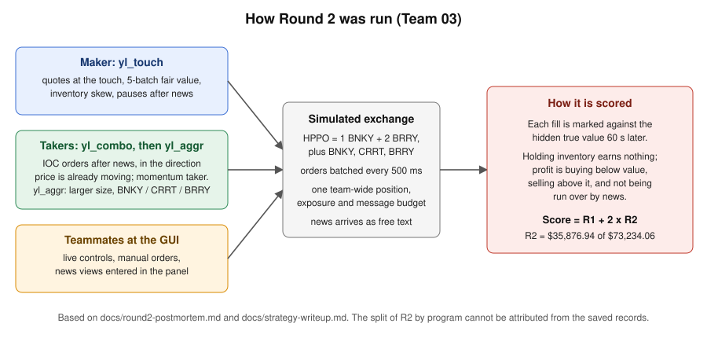

# PQT Trading Competition: market-making stack

**Can a replay-tuned market maker hold up in a live simulated market?** Partly. Team 03 (three students) finished **3rd** at the Princeton Quantitative Traders (PQT) one-day algorithmic trading competition on Nov 7, 2026, with **$73,234.06 in simulated P&L**. Almost all of it came from Round 2, after the Round 1 strategy, tuned on historical replay, got picked off live.

- **Read the strategy:** [docs/strategy-writeup.md](docs/strategy-writeup.md) covers the rules, scoring, backtests, stress tests and ideas that failed.
- **Check the work:** [Fill-level replay audit](research/audit/) (reproduces the tables in [docs/validation-and-limitations.md](docs/validation-and-limitations.md)) and the [Round 2 postmortem](docs/round2-postmortem.md), which states what the saved records can and cannot attribute.



*How Round 2 was run. Three programs and manual GUI orders shared one position, exposure and message budget. The score marks each fill against a hidden true value 60 seconds later. No leaderboard screenshot is saved in this repo, so this diagram is drawn from the documented setup.*

## Result

**Final standings** (score = R1 + 2 x R2, from the official leaderboard):

| | R1 | R2 | Total |
|---|---|---|---|
| Team 03 (3rd) | +$1,480.18 | +$35,876.94 | **+$73,234.06** |
| For scale: 1st place | +$1,623.32 | +$40,082.31 | +$81,787.93 |

R2 counts double, so it produced about 98% of the total. R1 was a learning round: the replay-tuned market maker was picked off in the live book, and we spent that session adapting the live controls.

## My contribution

I wrote the strategy code, research scripts, backtest tooling and the post-competition fill-level audit in this repository. Strategy files are prefixed `yl_` after me. Each program tags its orders with its own client-id prefix, so programs running side by side never cancel each other's orders, and a teammate's manual GUI order is never cancelled by mine.

During the live rounds I monitored whether the algorithms were working, using the 2-minute per-symbol markout readout in the logs and the team rule of cutting a symbol after consecutive negative readings. Teammates operated the trader GUI: they changed live controls, placed manual orders, and entered news views in the panel that `yl_touch` reads. The repo does not record which teammate did which.

## Findings

- **Prices trend over about a minute and HPPO leads.** Out-of-sample R² for the 60 s mid change, fit on odd sessions and tested on even ones: BRRY 0.23, HPPO 0.10, CRRT 0.09, BNKY 0.03.
- **Quoting around the forecast made things worse.** Shifting passive quotes toward the forecast lost $500 to $1,800 per session in replay. Quoting around a short moving average did better, and we never fully explained why. It may be a fill-model artifact.
- **Crossing the spread on HPPO's forecast paid in replay** (+5 to 6 cents/share after fees), but HPPO's exposure weight of 1.0 eats the budget needed by the other three books. Net change was within noise.
- **BRRY's wide spread was the robust edge.** It still paid with quotes 2 cents worse; BNKY and HPPO only paid when first in the queue.
- **Automatic per-symbol rotation by recent markout** gained only from upsizing winners. Cutting losers alone didn't help, so we kept it as a manual rule with a log readout.
- **News is where the money moves.** `yl_mm` pauses quoting after news, and `yl_news` trades the post-news drift with IOC orders that never rest on the book.

**What the progression looked like**

- **Replay backtests** (24 historical sessions, 60 s mid-markout proxy): the early market maker averaged about $4,100 per 45-minute session with no losing sessions. That is a replay number. The simulator fills a resting order only when a recorded trade prints through it and ignores queue position and other participants.
- **Sandbox and live round 1 were weaker and mixed.** Several sandbox runs were negative on the proxy, and quotes tuned on replay were picked off in R1, where the real market was about 1 cent wide. A CRRT headline cost the market maker roughly $2,400 of proxy PnL before we raised the news pause (to 240 batches) and traded around it by hand. Details are in [docs/live-and-sandbox-results.md](docs/live-and-sandbox-results.md).
- **Changes between R1 and R2:** quote at the touch (`yl_touch`), a much faster fair value (5 batches instead of 30), a longer news pause, and separate news and flow takers (`yl_combo`, `yl_aggr`) running alongside the market maker. The logs show `yl_touch` and `yl_combo` in R2, followed by the larger-size `yl_aggr`.
- **The GUI's estimated PnL is not the score.** At the end of R2 the trader showed an estimated PnL of about $25,154, and the official R2 score was $35,877. R1 showed about $1,306 against an official $1,480. The official score marks every fill against the hidden true value 60 s later, so it can differ a lot from a mark-to-market estimate.

**Takeaways.** A replay backtest overstates passive market-making edge, adverse selection around news dominates, and the live loop (monitoring, per-symbol cuts, panel controls, news handling) mattered as much as the model. The mid-markout proxy is only a stand-in for the official score.

**What this repo cannot show.** The saved logs do not support a split of the R2 score by maker, news taker, flow taker and manual orders, so any claim about which component earned how much is unsupported. [docs/round2-postmortem.md](docs/round2-postmortem.md) lists what is measured and what to log next time.

## The market

The market is a simulated exchange with four symbols: an ETF (`HPPO` = 1 `BNKY` + 2 `BRRY`) and three stocks (`BNKY`, `CRRT`, `BRRY`). Orders are batched every 500 ms, exposure and position limits apply, and news arrives as unlabeled free text. Each fill is scored against the hidden true value 60 seconds later, so holding inventory earns nothing. Profit comes from buying below value, selling above it, and not getting run over by news. Full rules and scoring are in [docs/strategy-writeup.md](docs/strategy-writeup.md).

## Setup

You need Python 3.10 or newer and the organizers' starter kit data, which is **not included here**. The historical data, official docs and SDK belong to the organizers: [tom05919/pqt-student-kit](https://github.com/tom05919/pqt-student-kit).

```bash
python -m venv .venv && . .venv/bin/activate
pip install -r requirements.txt
# download pqt-data-pack.zip from the starter-kit release, then:
unzip pqt-data-pack.zip        # creates data/
```

## Usage

```bash
# backtest one session with the SDK
pqt backtest strategies/yl_touch.py --data data --name s01

# score all 24 sessions with the 60 s markout proxy (parallel)
python tools/sweep.py strategies/yl_touch.py data

# train/test config grid
python tools/grid.py strategies/yl_alpha.py data configs.json

# run the research scripts
python research/regress.py data
python research/fit.py data

# run live or in the sandbox (needs your team key)
pqt run strategies/yl_mm.py --mode test --server https://sandbox.princeton-quant.com --key YOUR_KEY --cancel-on-disconnect
```

`yl_alpha.py` reads parameter overrides from environment variables (`PQT_CFG`, `PQT_ALPHA`, `PQT_TAKE`, ...), which `tools/grid.py` uses for config sweeps. Each program's docstring lists its live GUI controls.

### Reproducing the validation numbers

With the data pack in `./data` and the SDK installed:

```bash
AUDIT_DATA=data bash research/audit/run.sh      # takes several minutes; writes research/audit/out/ (git-ignored)
pytest tests
```

The baseline row (EMA-centred passive quotes, no taker) should come out at about $3,765 per session on the corrected metric.

## What's here

| Path | Contents |
|---|---|
| `strategies/yl_mm.py` | Four-symbol market maker used in round 1 and sandbox: fair value, inventory skew, exposure control, news pauses, live GUI controls, 2-minute markout monitor |
| `strategies/yl_mm_v1.py`, `yl_mm_v2.py` | Earlier versions of the market maker, kept for the history |
| `strategies/yl_touch.py` | Round 2 market maker: quotes at the touch with a much faster fair value, plus a news-view panel (a teammate enters a read of the news and it fires one order) |
| `strategies/yl_news.py` | IOC-only taker that trades just after news, in the direction price is already moving |
| `strategies/yl_flow.py` | Momentum/reversal taker (crosses the spread on 5-10 s moves) |
| `strategies/yl_combo.py`, `yl_aggr.py` | `yl_news` + `yl_flow` in one program; `yl_aggr` is the larger-size version used late in round 2 (HPPO is blocked in it; it trades the three stocks only) |
| `strategies/yl_alpha.py` | Market maker quoting around a regression forecast of the 60 s mid change |
| `research/` | Regression, jump and shock analysis, trading-day structure, taker study, log summarizer, control/news/view tests, and `yl_alpha_experimental.py` (an earlier forecast-quoting prototype) |
| `tools/` | Parallel backtest sweep with the 60 s markout proxy, config grid, per-fill markout, run-all |
| `research/audit/` | Fill-level replay audit: records every fill, applies the corrected 60 s markout, and reproduces the tables in `docs/validation-and-limitations.md` (`run.sh`) |
| `tests/` | Unit tests for the markout convention in `tools/sweep.py` |
| `docs/validation-and-limitations.md` | What the replay can and cannot tell you, measurement fixes, and signal checks net of costs |
| `docs/round2-postmortem.md` | Round 2 postmortem: what is measured, what cannot be attributed from the saved records, and the tests that would settle it |
| `docs/strategy-writeup.md` | Pre-competition analysis: rules, scoring, backtests, stress tests, ideas that failed |
| `docs/live-and-sandbox-results.md` | Per-session results from sandbox and live round 1 (generated by `research/summarize_log.py`) |
| `docs/code-review-and-v2-changes.xlsx` | Findings from a code review of v1 (13 items, mostly bugs), the v2 fixes, control tests, backtest and stress results, and monitor modes |
| `images/` | Diagram used in this README |

## Notes

- This is competition code. It was written fast and tuned on a small amount of data, and it is shared as a record of the work.
- No trading advice. The simulated market is not a real market.
